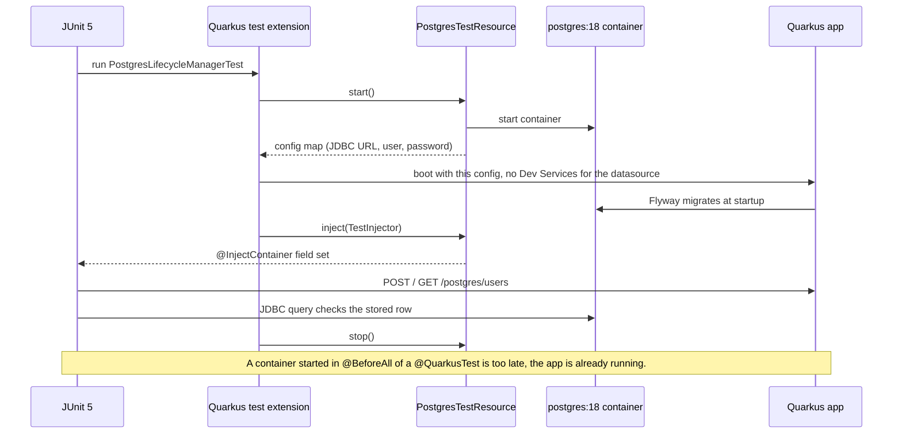

# quarkus-testcontainer

Example project showing four ways to test a Quarkus application against real infrastructure in
containers: PostgreSQL, MongoDB and S3 (emulated by [Floci](https://floci.io/aws/)).

The application is small: a user API backed by PostgreSQL (Hibernate ORM Panache + Flyway),
the same API backed by MongoDB (MongoDB Panache), and an export of the PostgreSQL users as a
JSON file to S3. The tests are the point of the repository.

## Prerequisites

- JDK 21
- Docker (Testcontainers and Quarkus Dev Services start containers)

Versions: Quarkus 3.40 (LTS), Testcontainers 2 (managed by the Quarkus BOM), Gradle wrapper 9.9,
images `postgres:18`, `mongo:8.0`, `floci/floci:2.5.0`.

## Commands

```shell
./gradlew build                                   # compile and run all tests
./gradlew test --tests 'com.mahennig.lifecycle.*' # run one pattern
./gradlew quarkusDev                              # dev mode, databases via Dev Services
```

Production mode reads its connections from the environment:

```shell
export DB_JDBC_URL=jdbc:postgresql://localhost:5432/app
export DB_USERNAME=app
export DB_PASSWORD=...
export MONGODB_CONNECTION_STRING=mongodb://localhost:27017
java -jar build/quarkus-app/quarkus-run.jar
```

Without `app.aws.endpoint` the S3 client talks to AWS in `app.aws.region` and uses the AWS SDK's
default credentials provider chain. Sample users (`db/seed`) are only loaded in the dev and test
profiles.

## Endpoints

| Method | Path | |
|---|---|---|
| GET | `/hello` | greeting |
| GET, POST | `/postgres/users` | list, create (201; 409 on duplicate email) |
| GET | `/postgres/users/{id}` | read (404 if unknown) |
| GET, POST | `/mongodb/users` | list, create (201; 409 on duplicate email) |
| GET | `/mongodb/users/{id}` | read by ObjectId (404 if unknown or malformed) |
| POST | `/exports/users` | export PostgreSQL users to S3, returns the object key |
| GET | `/exports/users/{key}` | load an export back (404 if unknown) |

## Testing patterns

Each pattern lives in its own package under `src/test/java/com/mahennig`. The PostgreSQL and
MongoDB patterns extend the same API contracts in `support/`, so they check the same behaviour and
differ only in how the database is provided.

| Pattern | Package | How the container starts | Use it when |
|---|---|---|---|
| Dev Services | `devservices` | Quarkus starts it because no URL / connection string is configured; no container code | the defaults are enough and you want the least code |
| Lifecycle manager | `lifecycle` | `QuarkusTestResourceLifecycleManager.start()` starts a Testcontainers container before Quarkus boots and returns its config as a map | you need control over image, setup or data, want the container injected into the test, or the service has no Dev Services |
| Plain Testcontainers | `plain` | JUnit 5 extension: `@Testcontainers` + `@Container` | the code under test does not need Quarkus (e.g. JDBC, migrations) |
| Floci | `floci` | `GenericContainer` (`floci/floci`, port 4566) in a lifecycle manager; the S3 client endpoint is set via `app.aws.endpoint` | the code talks to AWS APIs and you want a local emulator |

Who starts which container, and how the code under test finds it:

```mermaid
flowchart TB
    subgraph A["(a) Dev Services - devservices/"]
        A1["@QuarkusTest<br/>no URL in test profile"] -->|"Quarkus starts and wires"| A2[("postgres:18<br/>mongo:8.0")]
    end
    subgraph B["(b) Lifecycle manager - lifecycle/"]
        B1["TestResource.start()"] -->|"starts"| B2[("postgres:18<br/>mongo:8.0")]
        B1 -->|"returns config map<br/>JDBC URL, connection string"| B3["Quarkus app"]
        B3 --> B2
    end
    subgraph C["(c) Plain Testcontainers - plain/"]
        C1["@Testcontainers + @Container"] -->|"JUnit 5 extension starts"| C2[("postgres:18")]
        C3["Flyway + JDBC<br/>no Quarkus"] --> C2
    end
    subgraph D["(d) Floci - floci/"]
        D1["FlociTestResource.start()"] -->|"GenericContainer"| D2[("floci/floci:2.5.0<br/>port 4566")]
        D1 -->|"app.aws.endpoint"| D3["S3Client in the app"]
        D3 -->|"path-style S3 calls"| D2
    end
```



The order in pattern (b) is what makes it work: the container is running and its configuration is
known before Quarkus boots.



Notes from building these:

- A `@QuarkusTestResource` is global unless `restrictToAnnotatedClass = true`; a global one would
  also replace the databases of the Dev Services tests.
- Configuration returned from `start()` disables the matching Dev Service. The lifecycle tests
  therefore declare both the PostgreSQL and the MongoDB resource.
- `@Container` does nothing without `@Testcontainers`, and a container started in `@BeforeAll` of a
  `@QuarkusTest` is too late: Quarkus has already started.
- Floci: the S3 client uses path-style access, because virtual-hosted addressing against a
  `localhost` endpoint needs `<bucket>.localhost` to resolve. The Docker socket is not mounted;
  Floci needs it only for services that run containers, not for S3.

## Project structure

```
src/main/java/com/mahennig/
  GreetingResource.java      GET /hello
  common/UserRequest.java    request body shared by both user APIs
  postgres/                  JPA entity, service, REST resource
  mongodb/                   MongoDB Panache entity, service (unique index on email), REST resource
  s3/                        S3 client producer, app.aws.* config, user export
src/main/resources/
  application.properties     dev/test via Dev Services, prod via environment variables
  db/migration/              Flyway schema (source of truth, validated by Hibernate)
  db/seed/                   sample data, dev and test profiles only
src/main/docker/             Dockerfiles as generated by Quarkus 3.40 (not built by CI)
src/test/java/com/mahennig/
  support/                   shared API contracts and test data helpers
  devservices/               pattern: Dev Services
  lifecycle/                 pattern: QuarkusTestResourceLifecycleManager
  plain/                     pattern: plain Testcontainers + JUnit 5
  floci/                     pattern: S3 with Floci
.github/                     CI workflow and Dependabot
```

## Troubleshooting

`FATAL: invalid value for parameter "TimeZone": "Europe/Kiev"`: some JDK builds map the host time
zone to a legacy ID that PostgreSQL 18 rejects. The tests already run with `user.timezone=UTC`
(see `build.gradle`). For dev mode, use an up-to-date JDK or run
`./gradlew quarkusDev --jvm-args=-Duser.timezone=UTC`.
